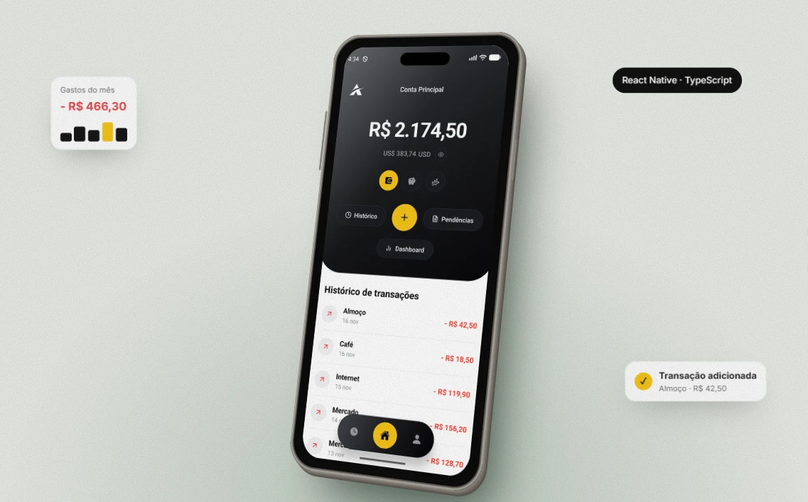

# Assgard

Aplicativo de finanças pessoais para Android e iOS, desenvolvido em React Native com Expo.

O Assgard reúne suas contas em um só lugar, mostra o saldo total em tempo real, registra entradas e saídas, avisa quando uma conta está perto de vencer e resume seus hábitos em um gráfico simples. Tudo fica salvo no próprio aparelho, sem servidor e sem cadastro obrigatório.




Os valores da imagem são dados de demonstração.

## Sumário

- [Funcionalidades](#funcionalidades)
- [Como rodar](#como-rodar)
- [Dependências](#dependências)
- [Estrutura do projeto](#estrutura-do-projeto)
- [Licença e uso livre](#licença-e-uso-livre)

## Funcionalidades

**Várias contas, um saldo só.** Conta principal, poupança e investimentos convivem no mesmo app. O saldo total aparece somado, e você alterna entre as contas sem sair da tela inicial.

**Conversão em dólar.** O saldo também é mostrado em dólar, com a cotação buscada na hora. Se a internet falhar, o app continua funcionando normalmente.

**Entradas, saídas e transferências.** Cada lançamento guarda nome, valor, conta e data, e entra diretamente no histórico.

**Histórico com busca.** Procure por nome ou valor, com os totais de entradas e saídas sempre à vista.

**Pendências com alarme.** Cadastre o que vence todo mês e receba uma notificação no dia. Contas atrasadas aparecem destacadas em vermelho.

**Dashboard.** Gráfico de barras com a movimentação por dia, para entender para onde o dinheiro está indo.

**Perfil.** Nome e foto editáveis, com o patrimônio total somado de todas as contas.

**Saldo oculto.** Um toque esconde todos os valores, para quando houver alguém olhando a tela.

Toda a informação é armazenada localmente com AsyncStorage. O app não envia seus dados financeiros para lugar nenhum.

## Como rodar

### O que você precisa antes

| Ferramenta | Versão | Observação |
|---|---|---|
| Node.js | 20 ou maior | O Expo SDK 54 não roda em versões anteriores |
| npm | 10 ou maior | Já vem junto com o Node |
| JDK | 17 | Só para Android. O Android Studio instala um junto |
| Android Studio | Qualquer versão recente | Para o emulador e o SDK do Android |
| Xcode | 15 ou maior | Só para iOS e funciona apenas no macOS |

Você não precisa de uma conta no Expo nem de nenhuma chave de API para rodar o projeto.

### Passo a passo

**1. Baixe o projeto**

```bash
git clone https://github.com/V1CTOR022/Assgard.git
```

```bash
cd Assgard
```

**2. Instale as dependências**

```bash
npm install
```

**3. Prepare um aparelho**

Abra o Android Studio, vá até o Device Manager e inicie um emulador. Ou conecte um celular Android por cabo, com a depuração USB ativada.

Para conferir se o aparelho foi reconhecido:

```bash
adb devices
```

**4. Compile e instale o app**

```bash
npx expo run:android
```

No macOS, para iOS:

```bash
npx expo run:ios
```

A primeira execução demora porque o Gradle compila todo o projeto nativo. Nas próximas, o app já estará instalado e você só precisa iniciar o servidor:

```bash
npx expo start
```

### Se algo der errado

**A tela fica branca e nada carrega.** Quase sempre é o servidor do Metro travado ou servindo arquivos de outra pasta. Encerre o processo que estiver usando a porta 8081 e inicie novamente, limpando o cache:

```bash
npx expo start --clear
```

**O app não encontra o servidor.** Em emuladores Android, redirecione a porta:

```bash
adb reverse tcp:8081 tcp:8081
```

**Erro de módulo nativo não encontrado após instalar uma dependência nova.** Dependências com código nativo exigem uma nova compilação. Não basta reiniciar o Metro. Execute `npx expo run:android` novamente.

### Sobre o Expo Go

O projeto foi testado com a compilação feita por `npx expo run:android`, que é o caminho recomendado aqui. O Expo Go até abre o app, mas as notificações das pendências dependem de agendamento nativo e não funcionam de forma confiável por lá.

## Dependências

### Base

| Pacote | Para que serve |
|---|---|
| `expo` | Plataforma e ferramentas de build |
| `react-native` | Framework do app |
| `react` | Biblioteca de interface |
| `typescript` | Tipagem estática, em modo estrito |

### Navegação

| Pacote | Para que serve |
|---|---|
| `@react-navigation/native` | Núcleo da navegação |
| `@react-navigation/native-stack` | Pilha de telas nativa |
| `@react-navigation/bottom-tabs` | Abas inferiores, com barra personalizada |
| `react-native-screens` | Telas nativas, para deixar a navegação mais fluida |
| `react-native-safe-area-context` | Respeita o notch e a barra de gestos |

### Animação e gestos

| Pacote | Para que serve |
|---|---|
| `react-native-reanimated` | Animações executadas na thread de UI |
| `react-native-worklets` | Executa funções de animação fora da thread de JS |
| `react-native-gesture-handler` | Arrastar e tocar com resposta nativa |

### Interface

| Pacote | Para que serve |
|---|---|
| `@expo/vector-icons` | Conjuntos de ícones |
| `expo-linear-gradient` | Degradês dos cartões e cabeçalhos |
| `react-native-svg` | Formas vetoriais, como o logo do Google |
| `expo-status-bar` | Controle da barra de status |

### Recursos do aparelho

| Pacote | Para que serve |
|---|---|
| `@react-native-async-storage/async-storage` | Armazena contas, lançamentos e pendências no aparelho |
| `expo-notifications` | Alarmes das contas a vencer |
| `expo-image-picker` | Escolha da foto de perfil |
| `expo-file-system` | Armazenamento da foto escolhida |

## Estrutura do projeto

```text
src/
├── assets/          imagens e logo
├── components/      componentes reutilizados entre telas
├── context/         estado global de contas e pendências
├── hooks/           lógica reutilizável
├── pages/           uma pasta por tela
├── services/        acesso a armazenamento, notificações e câmera
├── theme/           cores e estilos compartilhados
└── utils/           formatação de valores e datas
```

As telas nunca acessam diretamente os módulos nativos. Tudo passa por `services/`, o que mantém a interface separada da plataforma e facilita a portabilidade do app no futuro.

## Licença e uso livre

Este projeto é **open source**, sob a licença [MIT](LICENSE).

Na prática, isso significa que **você pode usar tudo daqui livremente**:

- Copiar o código, inteiro ou em partes.
- Modificar o que quiser.
- Usar em projetos pessoais, acadêmicos ou comerciais.
- Distribuir, publicar em lojas e até vender.

Não precisa pedir autorização nem pagar nada. A única condição é manter o aviso de copyright e o texto da licença junto às partes que você reutilizar. Se o projeto te ajudou, um crédito é bem-vindo, mas não é obrigatório.

O software é fornecido como está, sem garantias. Ele armazena dados financeiros apenas no aparelho e nunca passou por uma auditoria de segurança. Portanto, use por sua conta e risco.

## Autor

Feito por [Victor Yuri Vargas Koss](https://github.com/V1CTOR022).****
